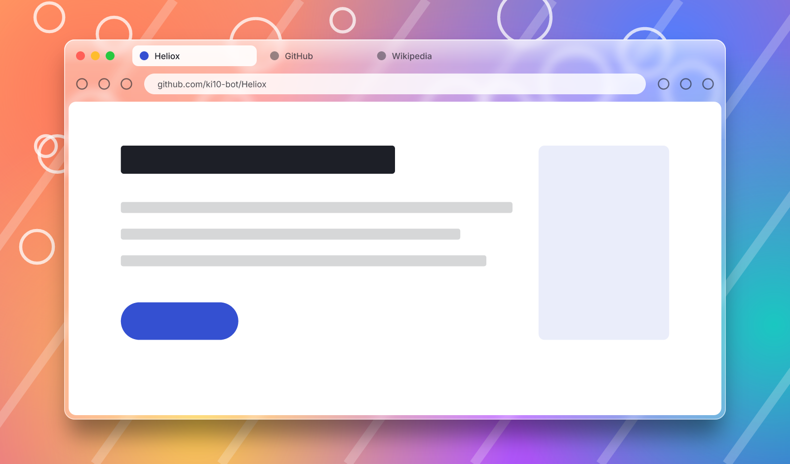
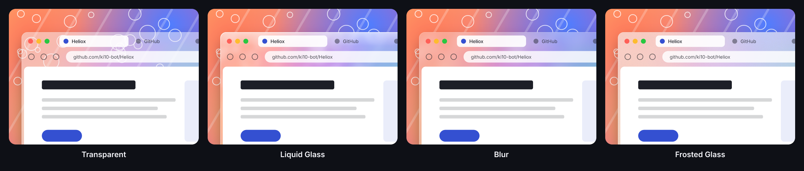

<p align="center">
  
</p>

<h1 align="center">Heliox</h1>

<p align="center">Helium, mit einem Hauch Sauerstoff.</p>



Heliox ist eine Modifikation für den [Helium Browser](https://helium.computer) auf dem Mac. Sie macht die Oberfläche des Browsers durchscheinend – in jedem Layout: Klassisch, Dynamisch, Kompakt und Vertikal.

In den Einstellungen erscheint dafür zwischen **Ausrichtung** und **Darstellung** der neue Bereich **Oberfläche**. Dort wählst du ein Material und stellst es nach deinem Geschmack ein.



| Material | Wirkung |
| --- | --- |
| **Transparent** | Der Schreibtisch scheint klar hindurch. |
| **Liquid Glass** | Das echte Glas von macOS: bricht und spiegelt, was dahinter liegt. |
| **Blur** | Der Hintergrund wird weichgezeichnet. |
| **Frosted Glass** | Milchiges, fein gekörntes Glas. |

Wer es lieber wie vorher mag, wählt **Deckend**.

## Installieren

Öffne das Terminal und füge diese Zeile ein:

```sh
curl -fsSL https://raw.githubusercontent.com/ki10-bot/Heliox/main/install.sh | bash
```

Dein bisheriges Helium wird gesichert. Tabs, Lesezeichen und Einstellungen bleiben erhalten.

## Entfernen

```sh
curl -fsSL https://raw.githubusercontent.com/ki10-bot/Heliox/main/uninstall.sh | bash
```

Danach ist wieder das originale Helium da.

---

Die Bilder sind Illustrationen. Heliox ist ein inoffizielles Projekt und steht nicht in Verbindung mit Helium oder imput. Lizenz: [GPL-3.0](LICENSE).
